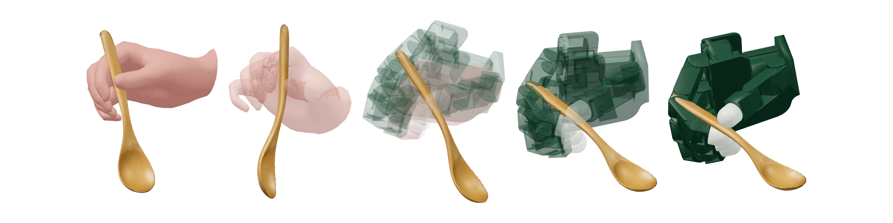
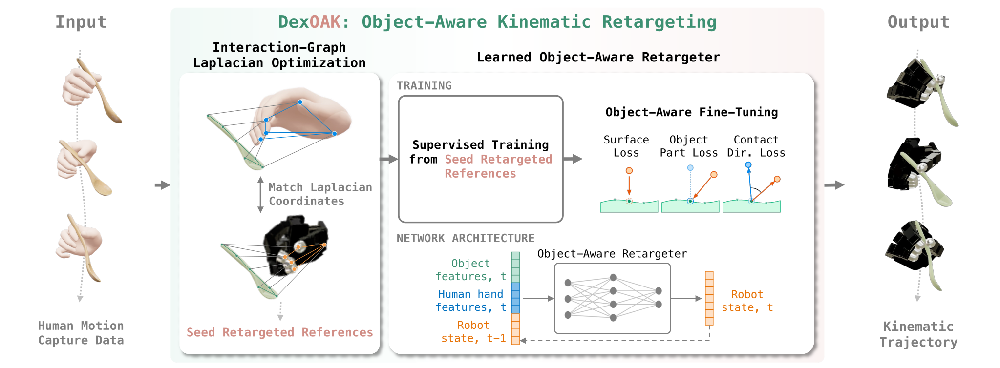

<p align="center"></p>
<h2 align="center">Object-Aware Kinematic Retargeting</h2>
<p align="center"><a href="https://sites.google.com/view/fede-spi/">Federica Spinola</a><sup>1</sup> · <a href="https://srl.ethz.ch/the-group/prof-robert-katzschmann.html">Robert Katzschmann</a><sup>2</sup> · <a href="https://cordeliaschmid.github.io">Cordelia Schmid</a><sup>1</sup><br><sup>1</sup>Inria · <sup>2</sup>ETH Zürich</p>
<p align="center"><a href="https://fspinola.github.io/dexoak/">Project website</a> · <a href="https://arxiv.org/pdf/2610.26762">Paper</a> · <a href="https://fspinola.github.io/dexoak/#video">Video</a>
<p align="center"></p>
<p align="center"></p>

DexOAK learns object-aware robot-hand kinematic trajectories from human hand–object motion. A first interaction-graph optimization step supplies seed retargeted references. Then, the supervised learning and contact-aware fine-tuning steps produce a learned retargeter that transfers to new demonstrations without per-frame optimization. Residual RL refines the references for physical execution.

- **Object-aware kinematics:** preserve the demonstrated hand–object interaction across different hand geometries.
- **Reusable retargeting:** learned kinematic retargeter transfers from OakInk-v2 to ARCTIC zero-shot or with in-domain fine-tuning.
- **Simulation and hardware results:** Allegro and Inspire evaluations in simulation on bimanual tasks demonstrate SOTA performance. Plus 46/56 open-loop hardware replays across five tasks on right-hand Allegro.

<p align="center"></p>

## Code release

Research code and checkpoints are not released yet. This branch contains the project overview and figures. Code and licensing information will be added here soon.

## Citation

```bibtex
@misc{spinola2026dexoak,
      title={DexOAK: Object-Aware Kinematic Retargeting}, 
      author={Federica Spinola and Robert Katzschmann and Cordelia Schmid},
      year={2026},
      eprint={2610.26762},
      archivePrefix={arXiv},
      primaryClass={cs.RO},
      url={https://arxiv.org/abs/2610.26762}, 
}
```
